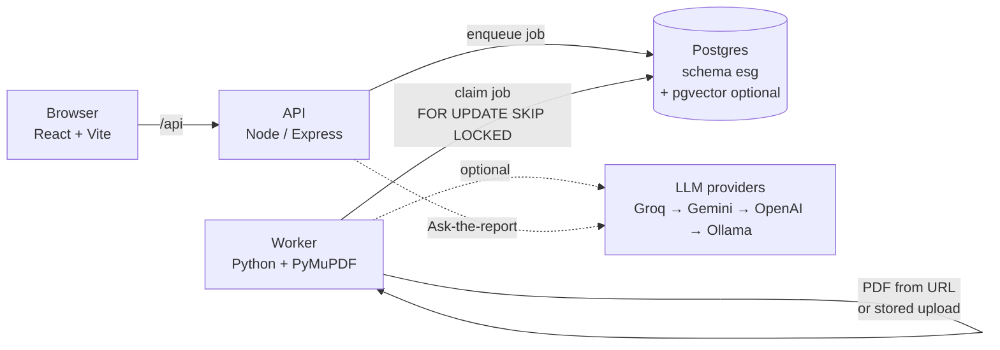

<p>
  <picture>
    <source media="(prefers-color-scheme: dark)" srcset="docs/brand/greenorb-logo-light.svg">
    
  </picture>
</p>

# GreenOrb: ESG report intelligence

GreenOrb reads corporate sustainability reports (BRSR, GRI, annual and integrated reports) and turns
them into **emissions and environmental figures you can check**:

- **Every number is cited.** Each Scope 1/2/3, energy, water and waste value links to the PDF page it
  came from, together with the text exactly as printed ("8,56,434 · Metric tonnes of CO2 equivalent").
- **Integrity flags.** GreenOrb checks for missing assurance, Scope 1 printed as nil, totals that don't
  add up, ±50% year-on-year swings, restatements, net-zero targets with no interim milestone, and
  carbon-neutral claims that lean on offsets. A reviewer confirms or dismisses each one.
- **Ask the report.** Questions about a company are answered from its own reports, with page citations.
- **Works without an LLM.** A layout-aware table parser does the core extraction deterministically.
  An LLM (Groq, Gemini, OpenAI or a local Ollama) is optional. It can only add values that GreenOrb
  then finds on the cited page; anything it can't find there is rejected.

> v4 (November 2026) is a rebuild of v3. The earlier code (globe layers, Web3 contracts, the
> duplicate frontends, and the old pipelines) is parked in [`archive/`](archive/README.md), which also
> lists the v3 bugs that caused the rebuild.

---

## Architecture



| Part | Folder | What it does |
| --- | --- | --- |
| Web app | `src/` | Dashboard, directory, company profile, report evidence view, review queue, ingest, globe |
| API | `Backend/` | REST API, migrations, auth for reviewers, ingestion queue, Ask-the-report |
| Worker | `worker/` | Downloads/opens PDFs, extracts and validates metrics, raises flags, indexes text |
| Database | `Backend/migrations/` | Everything lives in the `esg` schema. The v3 `public.*` tables are never modified. |

The API and the worker never call each other directly: the API inserts a row into `esg.jobs`, and the
worker claims it. They can run on different machines and the worker can be restarted at any time.
Jobs retry with backoff (1, 4, 16 min), and stuck jobs are re-queued after 30 minutes.

### How a report is read

1. **Fetch.** Uploads are stored in Postgres. URLs are downloaded with SSRF protection (public IPs
   only, every redirect re-checked, 80 MB cap). If the URL is a landing page, the worker follows its
   most report-like PDF link.
2. **Layout.** Every page is rebuilt into visual rows and cells using word coordinates. Scanned pages
   are OCR'd when Tesseract is installed.
3. **Tables (deterministic).** Row labels are matched to metrics (wrapped labels, narrative columns and
   intensity/ratio rows are handled). Each number is mapped to its column header by x-position
   (`FY2024-25`, `FY23 (Current Financial Year)`, `2019 … 2023`, Standalone/Consolidated groups), and
   units come from the unit cell or a nearby caption.
4. **Numbers and units by rule.** Indian (`8,56,434`), European (`1.234,5`) and footnoted
   (`164,236¹`) numbers are handled. **`MT` = metric tonnes** (as used in BRSR) while `Mt`/`MMT`/
   `million tonnes` = ×10⁶. Energy is converted to MWh and water to m³. When an energy or water unit
   can't be found, the value is dropped rather than guessed.
5. **LLM (optional).** The highest-scoring pages are sent to the model. Each value it returns must
   appear on the cited page; otherwise it is kept for transparency but marked *rejected*. A value
   where the table parser and the LLM agree gets ~0.97 confidence. A disagreement raises a review flag.
6. **Validate.** Assurance level and provider, frameworks, claims, and the flag rules in
   [`worker/greenorb_worker/flags.py`](worker/greenorb_worker/flags.py).
7. **Index.** Passages are stored for full-text search (and embeddings, if configured).
8. **Primary values.** For each company/metric/year, `esg.recompute_primary()` picks one value:
   reviewer-verified > manual > extracted > legacy, then consolidated > standalone, then the latest
   report (restatements), then grounded and confidence.

**Disclosure score (0–100)** for the latest year: Scope 1 (20), Scope 2 (20), Scope 3 (15), energy,
water and waste (10 each), and external assurance (limited 10, reasonable 15). It measures how
completely a company discloses, not how sustainable it is.

---

## Quick start (Docker, everything included)

```bash
cp .env.example .env          # set ADMIN_TOKEN; optionally GROQ_API_KEY / GEMINI_API_KEY
docker compose up --build
```

- Web: http://localhost:8080 (click **Reviewer sign-in** and paste your `ADMIN_TOKEN`)
- API health: http://localhost:5000/api/health

To process a folder of PDFs you already have:

```bash
REPORTS_DIR=/path/to/pdfs docker compose run --rm worker python -m greenorb_worker bulk /reports --limit 50
```

## Local development (no Docker)

You need Node 20+, Python 3.11+ and a Postgres 14+ database. A free [Neon](https://neon.tech)
database works and includes pgvector.

```bash
# 1. API (runs migrations on start)
cd Backend
cp .env.example .env            # set DATABASE_URL and ADMIN_TOKEN
npm install
npm run dev                     # http://localhost:5000

# 2. Worker (second terminal)
cd worker
python -m venv .venv && . .venv/bin/activate      # Windows: .venv\Scripts\activate
pip install -r requirements.txt
cp .env.example .env            # same DATABASE_URL
python -m greenorb_worker run

# 3. Web app (third terminal, from the repo root)
npm install
npm run dev                     # http://localhost:5173, proxies /api to :5000
```

### Useful worker commands

```bash
python -m greenorb_worker analyse report.pdf          # no database needed: prints metrics, flags, stats
python -m greenorb_worker analyse report.pdf --json
python -m greenorb_worker bulk ../Backend/downloaded_reports --retry-empty   # register + process local PDFs, 20 at a time
python -m greenorb_worker bulk ./pdfs --no-process    # only queue them
python -m greenorb_worker harvest --count 20          # queue public reports listed in worker/seeds/*.csv
python -m greenorb_worker drain --harvest 8           # top up from the seed lists, process the queue, exit
```

On Windows, double-click `worker\load-local-reports.cmd` to read everything in `Backend\downloaded_reports`.
It creates `worker\.venv` on first run, uses `worker\.env` for the database and LLM keys, reads with three
workers, also downloads the public reports in `worker/seeds/`, stops before the database passes 470 MB, and
writes `Backend\bulk-log.txt` and `Backend\bulk-skipped.csv` (every file it skipped, with the reason).

Before loading a PDF, `bulk` checks that it is a sustainability document (not a 10-K, press release or
rating profile) and that its first pages name the company in the file name; the old downloader saved
many reports under the wrong company. In a random sample of 61 files from `downloaded_reports`, 24 failed
these checks. `--no-screen` loads everything anyway.

**Database size.** Each report keeps its figures plus about 16 passages of text (always including every
page a figure or flag cites, which is what the evidence view shows): roughly 60–70 KB per report, so the
free 512 MB Neon plan holds a few thousand reports. Embeddings for Ask are off unless
`EMBEDDINGS_PROVIDER` is set, because vectors would add about 3 KB per passage. `/api/health` reports
`database_size_mb`.

`bulk` takes the company name from the file name (`tata_steel_ltd._sustainability_report_2024.pdf`
becomes "Tata Steel Ltd") and matches it to existing companies, ignoring suffixes like Ltd/Limited/Inc and
notes in brackets. File names that carry no company name ("2025_q-1,2_…") are skipped. Files are
de-duplicated by SHA-256 across all companies, so one PDF saved under several names is read once. It
processes each batch before reading more, so figures appear while it runs, and it can be stopped and
restarted. `--retry-empty` re-reads reports whose earlier pass found no figures. Jobs for local files are
only taken by a worker on the same machine; the GitHub Actions worker leaves them alone. Add `--store-files`
to keep the PDFs in Postgres so "Open PDF" works (this uses database storage; page text is always kept,
so the evidence view works without it).

### Keeping the database growing

Public figures come only from report pages: v3 imports without a source are kept on their report page,
marked unverified, but don't feed the directory, scores, map or overview (migration 004).

The scheduled workflow `Process report queue` runs every 30 minutes. When fewer than eight reports are
waiting it queues the next ones from `worker/seeds/*.csv` (newest first, one per company per run), then
downloads and reads them. Add rows to a seed file (`company,country,sector,year,url`) to widen coverage;
URLs already read are skipped. Set the repository variable `HARVEST_PER_RUN` to change the batch size.
After imports, spelling variants of the same company ("3i Group" / "3i Group plc") are merged by
`esg.merge_duplicate_companies()`, which keeps every report and figure.

### Migrating from v3

```bash
cd Backend
node scripts/import-legacy.js --from-db --dry-run     # preview (reads public.companies; never writes to it)
node scripts/import-legacy.js --from-db
# or from the JSON dump in the repo:
node scripts/import-legacy.js --from-json ../archive/data/legacy_companies_dump.json
```

This imports company names, sectors and countries. The few v3 Scope 1/2/3 figures that have a year
are stored as **unverified legacy values**: they never outrank re-extracted values and are flagged
`LEGACY_UNVERIFIED`. The v3 pipeline could inflate numbers by 1,000× or 1,000,000×, so re-ingest the
PDFs (`bulk`) to replace them with cited values.

---

## Configuration

| Variable | Where | Default | Notes |
| --- | --- | --- | --- |
| `DATABASE_URL` | API, worker | — | Required. Neon: use the connection string with `sslmode=require`. |
| `ADMIN_TOKEN` | API | — | Reviewer token (long random string). Without it, ingest/review/edit are disabled. |
| `PUBLIC_INGEST` | API | `false` | Allow anyone to submit reports (rate-limited to `INGEST_RATE_LIMIT_PER_HOUR`). |
| `ALLOWED_ORIGINS` | API | — | Comma-separated browser origins (e.g. your Vercel URL). localhost is allowed in dev. |
| `LLM_PROVIDERS` | API, worker | `groq,gemini,openai,ollama` | Order of fallback. Only providers with a key/URL are used. |
| `GROQ_API_KEY`, `GROQ_MODEL` | API, worker | `llama-3.3-70b-versatile` | |
| `GEMINI_API_KEY`, `GEMINI_MODEL` | API, worker | `gemini-2.5-flash` | Uses Gemini's OpenAI-compatible endpoint. |
| `OPENAI_API_KEY`, `OPENAI_MODEL`, `OPENAI_BASE_URL` | API, worker | `gpt-4o-mini` | Any OpenAI-compatible server works. |
| `OLLAMA_BASE_URL`, `OLLAMA_MODEL` | API, worker | `llama3.1:8b` | Fully local option. |
| `EMBEDDINGS_PROVIDER` | API, worker | `auto` | `gemini` / `openai` / `ollama` / `none`. On the worker `auto` means `none` (vectors are opt-in to save space). **Must match** on API and worker (768-dim). |
| `PASSAGE_LIMIT` | worker | `16` | Passages kept per report for Ask and evidence, beyond the pages that are cited (`0` keeps all). |
| `MAX_UPLOAD_MB` | API | `40` | |
| `STORE_FETCHED_PDFS` | worker | `false` | Keep URL-downloaded PDFs in Postgres. |
| `LLM_MAX_CALLS_PER_REPORT` | worker | `4` | Caps LLM cost and rate-limit pressure per report. |
| `VITE_API_BASE` | web build | — | API origin when the web app is hosted separately (e.g. `https://greenorb-api.onrender.com`). |

Model names change over time. If a provider retires a model, set the `*_MODEL` variable; nothing
else needs to change.

---

## Deployment

**Option A: one small server** (simplest and most robust). Run `docker compose up -d` on any VPS
with 1 GB+ RAM. The web app, API, worker and Postgres all run there.

**Option B: free-tier cloud.**

1. **Database:** create a Neon project and copy the connection string.
2. **API:** deploy `render.yaml` as a Render Blueprint (or create a Node web service with root
   `Backend`, start `node index.js`, health check `/api/health`). Set `DATABASE_URL`,
   `ALLOWED_ORIGINS` and any LLM keys. `ADMIN_TOKEN` is generated for you.
3. **Web:** import the repo in Vercel (root directory = repo root) and set `VITE_API_BASE` to the
   Render URL.
4. **Worker:** either keep the paid Render background worker from `render.yaml`, or use the free
   GitHub Actions runner: add the repository secret `DATABASE_URL` (plus LLM keys). The workflow
   [`worker-drain.yml`](.github/workflows/worker-drain.yml) then processes the queue every 30
   minutes, and you can also run it by hand from the Actions tab.

---

## API reference (`/api`)

| Method | Path | Auth | Purpose |
| --- | --- | --- | --- |
| GET | `/health` | – | DB status, configured providers, worker liveness |
| GET | `/stats` | – | Dashboard totals, recent flags/reports, sector breakdown |
| GET | `/companies?q&sector&country&has_data&sort&order&page&limit` | – | Directory with latest primary values |
| GET | `/companies/facets`, `/companies/suggest?q=` | – | Filter options, autocomplete |
| GET | `/companies/:slug` | – | Profile: summary, metric series, reports, flags |
| POST / PATCH | `/companies`, `/companies/:slug` | reviewer | Create or edit company details (sector, HQ coordinates…) |
| GET | `/reports?status`, `/reports/:id` | – | Report with every extracted value, evidence and flags |
| GET | `/reports/:id/file` | – | Stored PDF (append `#page=N`) or redirect to the source URL |
| GET | `/reports/:id/pages/:page` | – | Text of one page as read, the figures taken from it, and the neighbouring pages (the evidence view) |
| POST | `/reports/:id/reprocess` | reviewer | Re-queue a report |
| DELETE | `/reports/:id` | reviewer | Delete a report and its values |
| PATCH | `/metrics/:id` | reviewer | `{status: verified\|rejected\|extracted, value?, note?}` |
| GET | `/flags?status&severity&code&company` | – | Review queue |
| POST | `/flags/:id/review` | reviewer | `{status: confirmed\|dismissed\|open, note?}` |
| POST | `/ingest` | reviewer* | multipart: `file` **or** `url`, plus `company_name` or `company_slug`, optional `country`, `fiscal_year` |
| GET | `/jobs`, `/jobs/:id` | – | Queue status, progress and logs |
| POST | `/ask` | – | `{company, question, report_id?}` → answer + cited passages (rate-limited) |
| GET | `/globe` | – | Companies with known locations (exact or country-level) |

\* or anyone, when `PUBLIC_INGEST=true`. Reviewer requests send `Authorization: Bearer <ADMIN_TOKEN>`.
Every reviewer action is recorded in `esg.audit_log`.

## Tests

```bash
cd worker && pip install -r requirements-dev.txt && python -m pytest -q        # 51 tests, no DB needed
cd Backend && TEST_DATABASE_URL=postgresql://… npm test                        # 13 tests (drops/recreates schema esg!)
npm run build                                                                  # web app
```

CI ([`.github/workflows/ci.yml`](.github/workflows/ci.yml)) runs all three on every push.

## Known limitations

- Figures that only appear in charts or images can't be read by the table parser. With an LLM
  configured, values written in prose are picked up; otherwise the report gets a `NO_GHG_DATA` flag.
- Scope 3 is stored as a total. Individual categories are skipped.
- Flags are signals for review, not verdicts. The net-zero and offsets checks are keyword heuristics.
- Company headquarters coordinates are only exact when set (via `PATCH /companies/:slug`). Otherwise
  the globe groups companies by country.

## Security notes

- **Revoke the two Gemini API keys that were committed in v3** (they were redacted in v4 but remain
  in git history).
- The reviewer token is never built into the frontend. Each reviewer pastes it into their own browser.
- All SQL is parameterised; inputs are validated with zod; uploads must be real PDFs; URL fetching
  blocks private networks.

## Brand

The logo lives in `docs/brand/`: `greenorb-logo.svg` (dark text, for light backgrounds), `greenorb-logo-light.svg`
(light text, for dark backgrounds), `greenorb-orb.svg` (app icon) and the designer's original file. In the web app use
the `<Logo />` and `<Orb />` components from `src/components/Logo.jsx`; don't redraw or recolour the orb.
